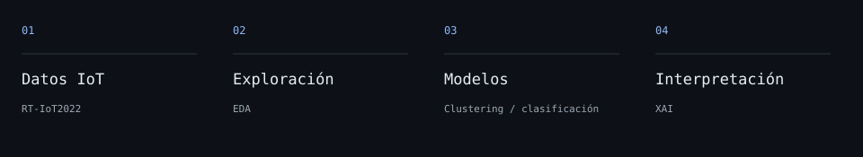
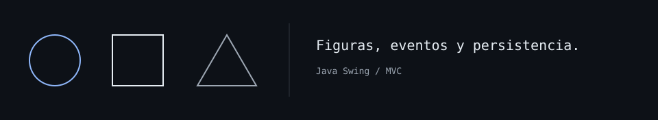

<div align="center">

<table><tr><td align="center"><a href="https://www.linkedin.com/in/mart%C3%ADn-jos%C3%A9-garc%C3%ADa-navarro-161761397/">LinkedIn</a></td><td align="center"><a href="https://www.linkedin.com/in/mart%C3%ADn-jos%C3%A9-garc%C3%ADa-navarro-161761397/">Let&#x27;s connect</a></td><td align="center"><a href="mailto:mjpj0609@gmail.com">Email</a></td><td align="center"><a href="https://github.com/MartinAI100?tab=followers">Follow</a></td></tr></table>

<a href="https://github.com/MartinAI100?tab=repositories">Explore my repositories</a>

</div>

```text
                                    @@@@#+:.
                               +:++++:::::. ....
                            :....:: .::+@+.       ::
                          ++.        .::::.        ..
                         #@:::++++#+:::++.  ::::::  ..:
                         +:.@@@@@@@@@@@@##@#@@@@@@#:  .
                           :@@@@@@@@@@@@@@@@@@@@@@@:
                           :@@@@@@@@@@@@@@@@@@@@@@@:
                         :::@@@@@@@@@@@@@@@@@@@@@@@@:::
                          @ @%+.    .%@@@%      .,= @@
                           @                       *@
                           @@         @@@         ,@
                            @@@@###%%%%%%%%%%#*#@@@@
                             @@@@@%%%;=#;#%%%@@@@@@
                            +;%@@%*,.,@@@%+ .+%@@+.+%@#
                     @@*+#@%#* :@++@*@@*@@@@;:;#@ ;*#%#*++##@@@
               @@@@@@#++*#*###  @@#.@@@  @@@@ *@+ +******+++###@@@@@@@
         @#@@@@####+::+#@@#****  %+@@@@@@,=@@@.   #+++*#@@:::++++++####@+
        ##+###+++++++:::#@#+**#   @@@@@ @@@*@@@   *++++#+:+++::++++++:++:#
      #@##:+++++++::##@@###*+*+  @@@@@@  @@@@@@@  =+++++++#@@:+::++++:+::.+
     @#:::::+++::::::######+:  @@@@@@%.   #@@@@@@%  =+++++#+.::::::+:.: .::+
    @##+:.. :+::::::::#++++  =@@@@@@@*%: %@@@@@@@@@,  .++##.::::::::: ......++
   ++:::::.  ::::::::.:+++@@@@@@@@@@@+,   +@@@@@@@@@@@::++..:..:::::      ...:
   #+:::...  ::::....::###@@@@@@@@*          *@@@@@@@@@@#:..   ....   .......::
  ++:++++::.   ...:+##@##+@@@@@@=               #@@@@@@@+++++:..    :.::::::::+
 ++####++::..::+####++++++:@@@#:                ::@@@@@#.:::+++#+:::..:::+++++++
@@##+::::+:.:####++::::::+:++:                    ::@@@::..:::::+++#++::::::++##
+:::+++##::++++::::::::::::+: :.:               :.. :::.:........:::+++++++::.::
::+##++:.:+:::......:.. .:::: .                  :.  .... ............::::::++:.
:+:::::.::.........      .                        .    .      . ..............::
```

## About Me

I'm a developer based in Madrid, focused on machine learning, deep learning and RAG systems. I work with Python, Java and SQL on data analysis, predictive modelling and practical applications.

Madrid, Spain · Spanish / English

## Selected projects

### [Attack Pattern Private Study](https://github.com/MartinAI100/Attack-Pattern-Private-Study)

An IoT traffic study using RT-IoT2022: exploring the data, comparing clustering and classification models, and interpreting their predictions.

- PCA, K-Means and Fuzzy C-Means for exploring patterns.
- SHAP, LIME and ELI5 for model interpretation.



Python · scikit-learn · XGBoost · XAI

[Read the study](https://github.com/MartinAI100/Attack-Pattern-Private-Study#readme)

### [GeoDraw](https://github.com/MartinAI100/Proyecto-POO)

A Java desktop application for creating and saving geometric shapes, with a Swing interface and an MVC architecture.

- Shape creation and interaction through a desktop interface.
- Separate model, view and controller, with shape persistence.



Java · Swing · MVC

[Explore the project](https://github.com/MartinAI100/Proyecto-POO#readme)

## Tools I use

| Area | Tools |
| :--- | :--- |
| Languages | Python · Java · SQL |
| Data | NumPy · pandas · SciPy |
| Machine learning | scikit-learn · XGBoost · scikit-fuzzy |
| Visualisation | Matplotlib · Seaborn · Plotly |
| Explainability | SHAP · LIME · ELI5 |
| Workflow | Jupyter · VS Code · Git |

## GitHub statistics

<!-- STATS:START -->

Actualización de estadísticas pendiente

<!-- STATS:END -->

<!-- ACTIVITY:START -->

## Actividad

Actualización pendiente

<!-- ACTIVITY:END -->


